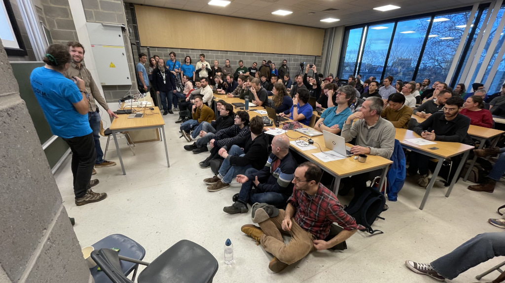
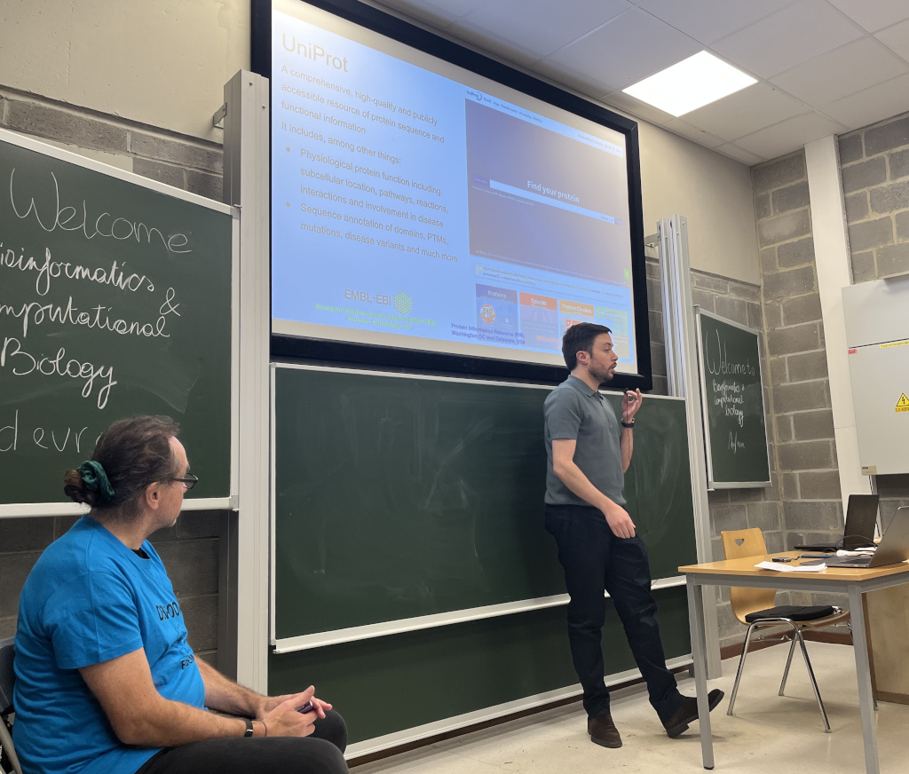
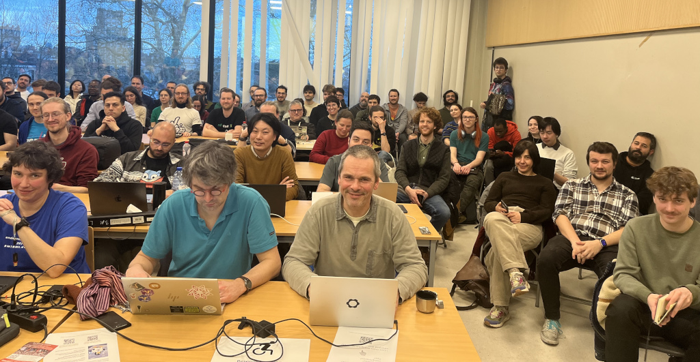
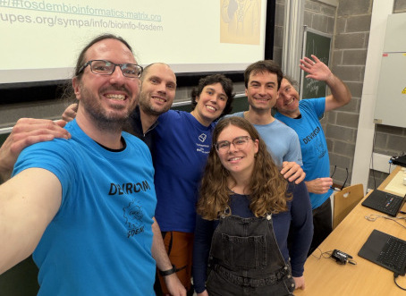

# Call for Participation: 2nd Bioinformatics and Computational Biology Developer Room at FOSDEM 2027

**The Bioinformatics and Computational Biology FOSDEM community is pleased to announce the return of our DevRoom and invites participants to submit proposals for talks for the event. It will take place on the afternoon of Saturday January 30 in Belgium, at the [Université Libre de Bruxelles (ULB)](https://www.openstreetmap.org/relation/13699100#map=18/50.813724/4.382805)**

### General Information about FOSDEM

FOSDEM is a free and non-commercial two-day weekend event organized annually in Brussels, Belgium. It brings together 8000+ open source developers and enthusiasts from around the world. No registration or payment is necessary. FOSDEM provides a unique opportunity for developers and communities to meet, share knowledge, and promote the development and benefits of open source solutions.

### Bioinformatics & Computational Biology

Over the past two decades, biology has been transformed by high-throughput technologies that generate vast amounts of data. This revolution created demand for efficient algorithms, parallel computing infrastructures (GPUs, HPC, cloud platforms), and sophisticated software tools. Open-source software is integral to this landscape.

Bioinformatics bridges engineering, computer science, and biology. We define it broadly to encompass: 
* Genomics
* Medical imaging (i.e. radiology, digital pathology)
* AI-driven protein research
* Medical informatics and med-tech
* ... Any field at the intersection of life sciences and technology that has a FOSS angle

### The Devroom

Following a successful [Birds of a Feather session at FOSDEM 2025](https://archive.fosdem.org/2025/schedule/event/fosdem-2025-6747-fos-4-bioinformatics-computational-biology/) and a very well visited and appreciated [DevRoom track in 2026](https://archive.fosdem.org/2026/schedule/track/bioinformatics/), both drawing many attendees from diverse backgrounds, we're happy to announce the second installment of our Bioinformatics & Computational Biology devroom.

### Call for presentations

_Submission deadline: November 30, 2026_

We invite proposals from developers, researchers, and any enthusiasts working with open source tools in the life sciences. Whether you're from academia, industry, or the public sector, we want to hear about:
    
* Best practices and emerging approaches
* FOSS projects and tools (technical presentation)
* Workflow Management & HPC (tutorials and demos are OK)
* Reproducibility and open science (best practices)
* Software Engineering and UX
* AI & Machine Learning applications
* Visualization and interactive tools

We especially encourage submissions that:

* Address practical challenges with real-world solutions
* Cover the biological context driving computational choices
* Showcase cross-disciplinary collaboration
* Highlight lessons learned from FOSS development in life sciences

Note: All talks will be live-streamed and recorded (audio+video). By submitting, you agree to being recorded and that your content will be published under a Creative Commons (CC-BY) license.

#### How to submit a talk

- Go to [the submission page on FOSDEM pretalx](https://fosdem.org/submit)
- Click "Submit a propoposal"
- Indicate the duration in the title (20min, 10min or 5 min)
- Select 'Bioinformatics & Computational Biology' from the 'Track' field

Note: Organizers may request shorter talk formats if we receive more submissions than we can accommodate.

If you cannot use Pretalx for any reason, contact us via the mailing list (https://framagroupes.org/sympa/info/bioinfo-fosdem) or join our public Matrix space.

###  Join our community

* Matrix room: https://matrix.to/#/#fosdem-bioinfo:matrix.org
* Mailing list: https://framagroupes.org/sympa/info/bioinfo-fosdem

We look forward to your submissions and to seeing you at FOSDEM 2027!

### The Bioinformatics & Computational Biology Devroom Team

_The 2026 team, FLTR:_

* Alessandro Pilotti - Open Source Cloud Computing and Bioinformatics
* Freek van Hemert - Next-Generation Sequencing Data Analysis and Infrastructure
* Elena Grassi - Computational Biologist, Bioconductor/Bioconda contributor
* Marie Hannaert - Bioinformatician
* Alexis Praga - Medical Doctor, Ph.D in HPC
* Jim Procter - Computational Scientist, FOSS Community
* Olga Kalinina (new 2027 member) - Professor in Bioinformatics, FOSDEM enthusiast
